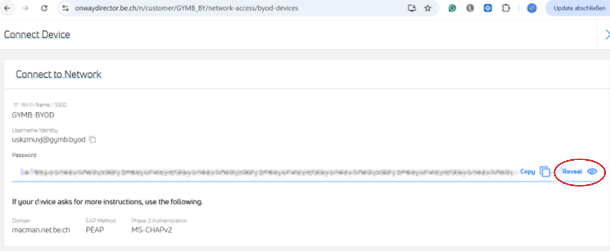
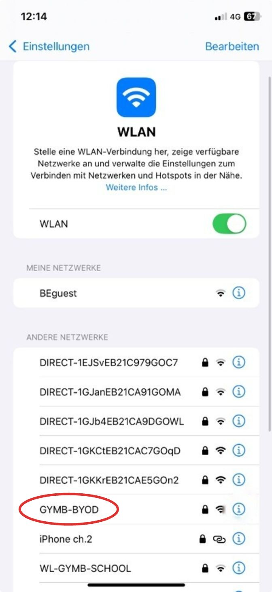
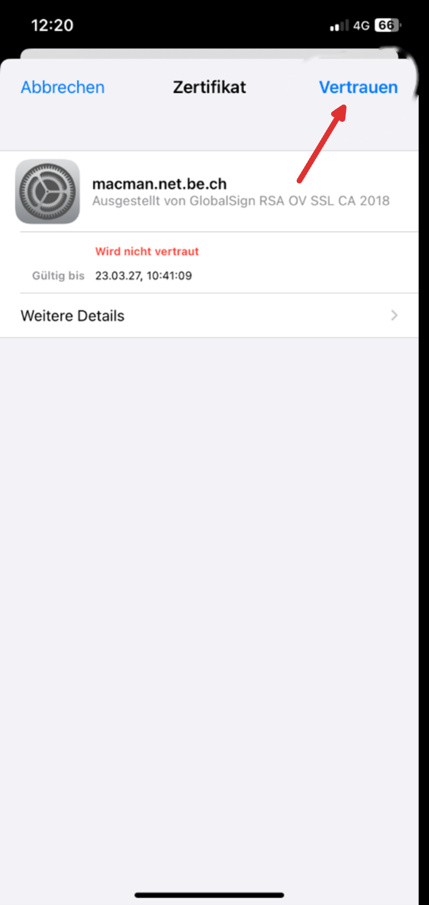
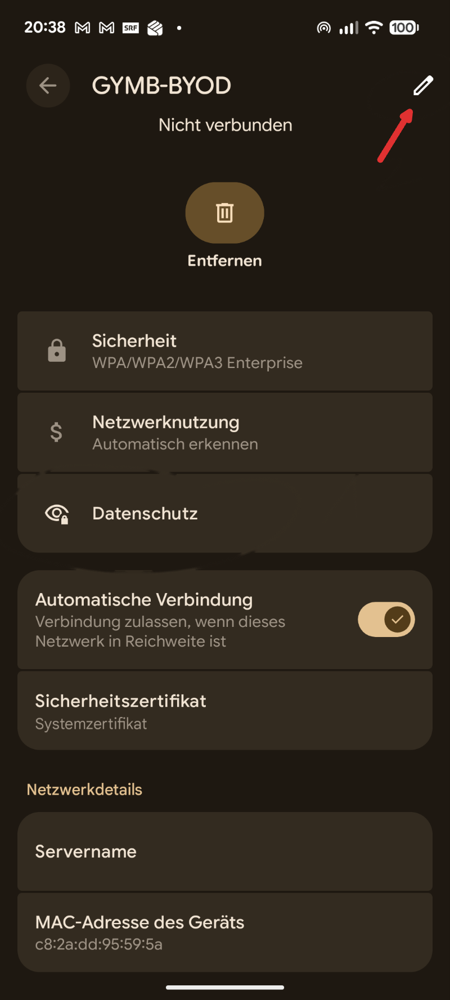
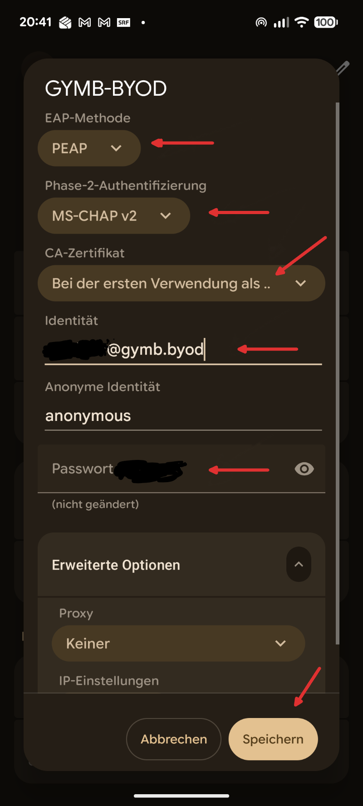
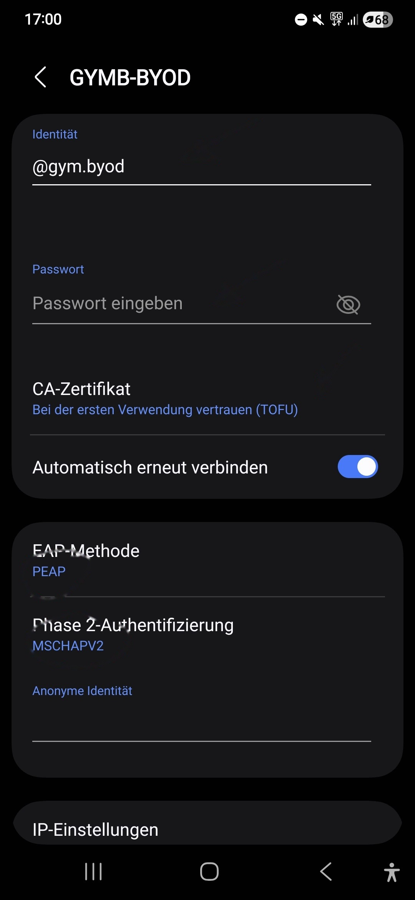
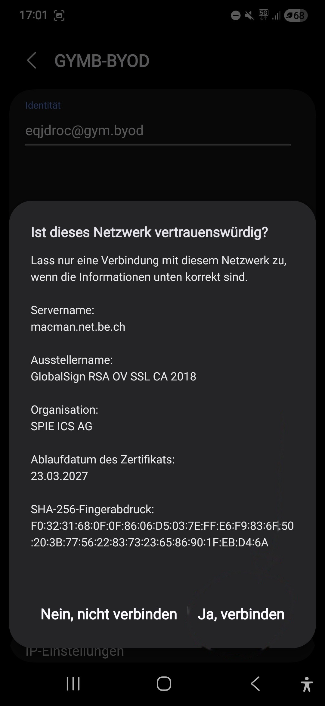

import WlanMacKeinInternet from '@site/docs/03-support/01-faq/questions/_wlan-mac-kein-internet.mdx';
import WlanGeraetGefaehrdet from '@site/docs/03-support/01-faq/questions/_wlan-geraet-gefaehrdet.mdx';
import WlanPrivateAdresse from '@site/docs/03-support/01-faq/questions/_wlan-private-adresse.mdx';
import WlanTrackingErlauben from '@site/docs/03-support/01-faq/questions/_wlan-tracking-erlauben.mdx';
import WlanZugangsdatenAbgelehnt from '@site/docs/03-support/01-faq/questions/_wlan-zugangsdaten-abgelehnt.mdx';

# WLAN

Mit dieser Anleitung verbinden Sie Ihr Gerät mit dem Schul-WLAN __GYMB-BYOD__.

## Anleitung

**Die Schritte 1–5 sind nur beim ersten Mal nötig** oder wenn Sie Ihre Zugangsdaten nicht mehr finden. Sonst beginnen Sie direkt bei Schritt 6. Die Zugangsdaten gelten für alle Ihre Geräte, auch für Smartphone und Tablet.

<Steps>
    1. In der Schule mit dem **Laptop** mit dem WLAN __BEGuest__ verbinden. Über einen Hotspot funktioniert es nicht.
    2. Im Browser den [Onway Director](@onway-director-login) öffnen.
    3. Mit der Schul-E-Mail-Adresse (`vorname.name@edu.gbsl.ch`, Lehrpersonen: `vorname.name@gbsl.ch`) und dem dazugehörigen Passwort anmelden.
    4. Auf den blauen Button mit dem __+__ klicken.
       :::flex
       ::br{.noFlex}
       
       ::br{.noFlex}
       
       :::
    5. Benutzername und Passwort anzeigen (__Reveal__) und notieren.
       
       :::danger[Zugangsdaten jetzt notieren]
       Notieren oder fotografieren Sie Benutzername und Passwort **jetzt**. Sie brauchen sie auch später wieder: Wird die Verbindung getrennt, melden Sie sich mit denselben Zugangsdaten neu an. Für GYMB-BYOD gelten **nur diese Zugangsdaten**, nicht Ihre Schul-E-Mail-Adresse.
       :::
    6. Das Gerät mit __GYMB-BYOD__ verbinden:
       <Tabs groupId="os" queryString>
           <TabItem value="win" label="Windows">
               1. Mit dem WLAN __GYMB-BYOD__ verbinden.
               2. Benutzername und Passwort aus dem Onway Director eingeben.
           </TabItem>
           <TabItem value="macos" label="macOS">
               1. Mit dem WLAN __GYMB-BYOD__ verbinden.
               2. Benutzername und Passwort aus dem Onway Director eingeben.
           </TabItem>
           <TabItem value="ios" label="iOS">
               1. __Einstellungen__ > __WLAN__ öffnen, __GYMB-BYOD__ antippen und Benutzername und Passwort aus dem Onway Director eingeben.
                  
               2. Das Zertifikat mit __Vertrauen__ bestätigen.
                  
           </TabItem>
           <TabItem value="android" label="Android">
               <Tabs groupId="android-hersteller" queryString>
                   <TabItem value="pixel" label="Google Pixel">
                       1. In den Einstellungen unter __WLAN__ auf __GYMB-BYOD__ tippen.
                       2. Oben rechts auf das Stiftsymbol tippen.
                          
                       3. Folgendes einstellen und auf __Speichern__ tippen:
                          - __EAP-Methode__: __PEAP__
                          - __Phase-2-Authentifizierung__: __MS-CHAP v2__
                          - __CA-Zertifikat__: __Bei der ersten Verwendung als …__
                          - __Identität__: Benutzername aus dem Onway Director
                          - __Passwort__: Passwort aus dem Onway Director

                          
                   </TabItem>
                   <TabItem value="samsung" label="Samsung">
                       1. In den Einstellungen unter __WLAN__ auf __GYMB-BYOD__ tippen.
                       2. Folgendes einstellen und auf __Verbinden__ tippen:
                          - __Identität__: Benutzername aus dem Onway Director
                          - __Passwort__: Passwort aus dem Onway Director
                          - __CA-Zertifikat__: __Bei der ersten Verwendung vertrauen (TOFU)__
                          - __EAP-Methode__: __PEAP__
                          - __Phase 2-Authentifizierung__: __MSCHAPV2__

                          
                       3. Mit __Ja, verbinden__ bestätigen.
                          
                   </TabItem>
               </Tabs>
           </TabItem>
       </Tabs>
</Steps>

## Problemlösungen

<WlanZugangsdatenAbgelehnt />

<WlanPrivateAdresse />

<WlanMacKeinInternet />

## Häufige Fragen

<WlanTrackingErlauben />

<WlanGeraetGefaehrdet />
