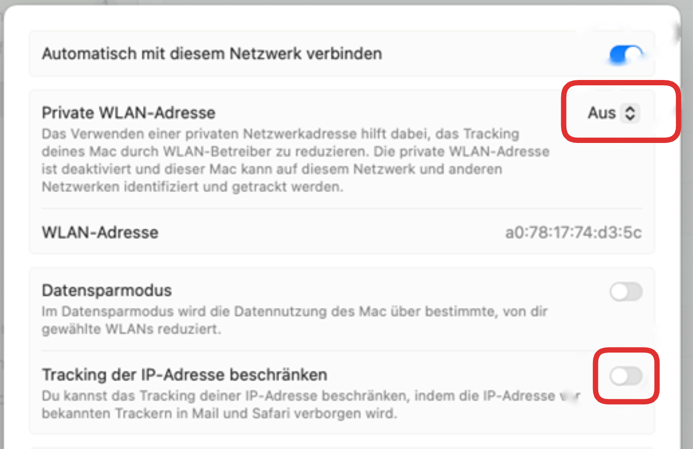
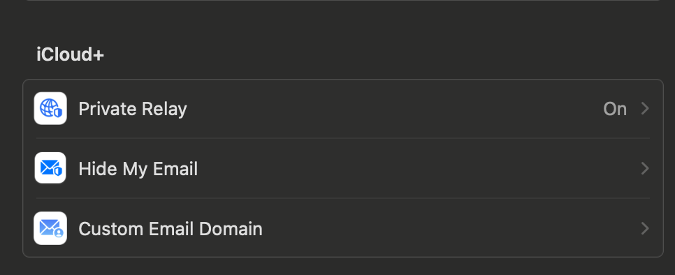

<Faq>
    #### Mein Mac ist mit __GYMB-BYOD__ verbunden, aber ich komme nicht ins Internet. Was kann ich tun?
    <Solution>
        Schalten Sie für GYMB-BYOD die Option __Tracking der IP-Adresse beschränken__ aus:

        <Steps>
            1. __Systemeinstellungen__ > __Netzwerk__ > __WLAN__ öffnen und bei __GYMB-BYOD__ auf :mdi[information-outline] klicken.
            2. __Tracking der IP-Adresse beschränken__ ausschalten.
               
        </Steps>

        Hilft das nicht, schalten Sie __Privat-Relay__ aus: __Systemeinstellungen__ > __[Ihr Name]__ > __iCloud__ > __Privat-Relay__.
        
    </Solution>
</Faq>
