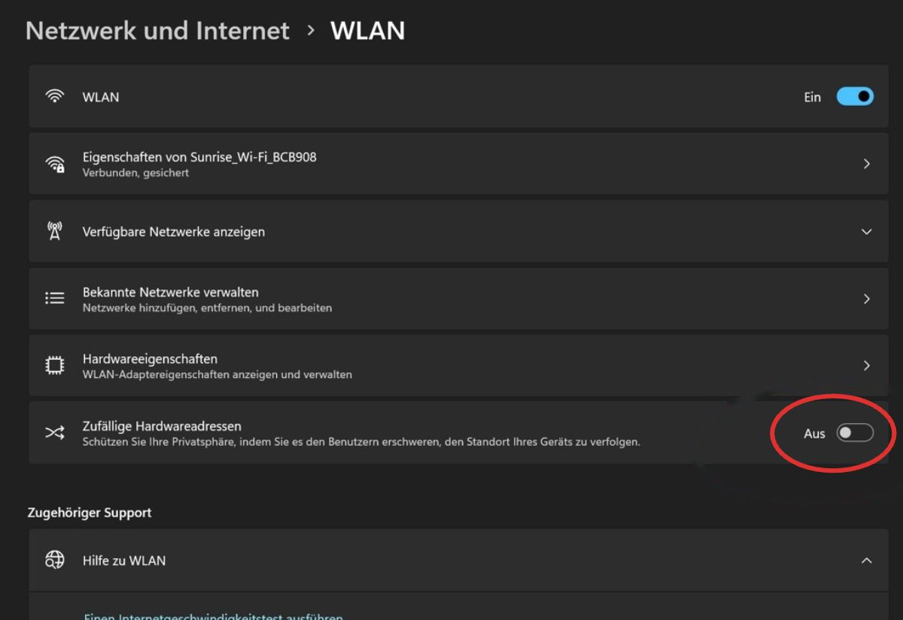
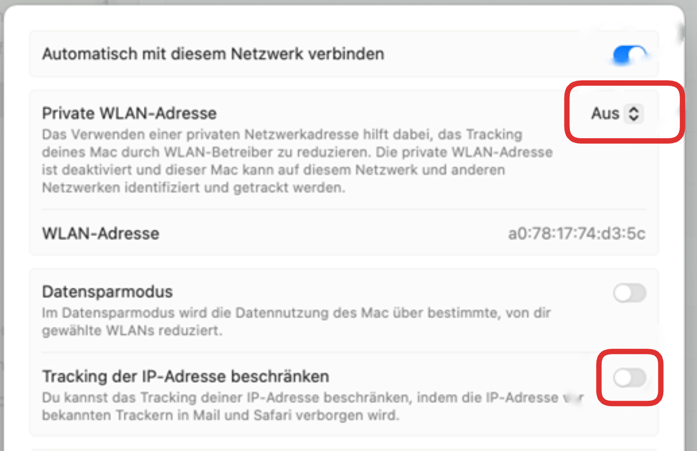
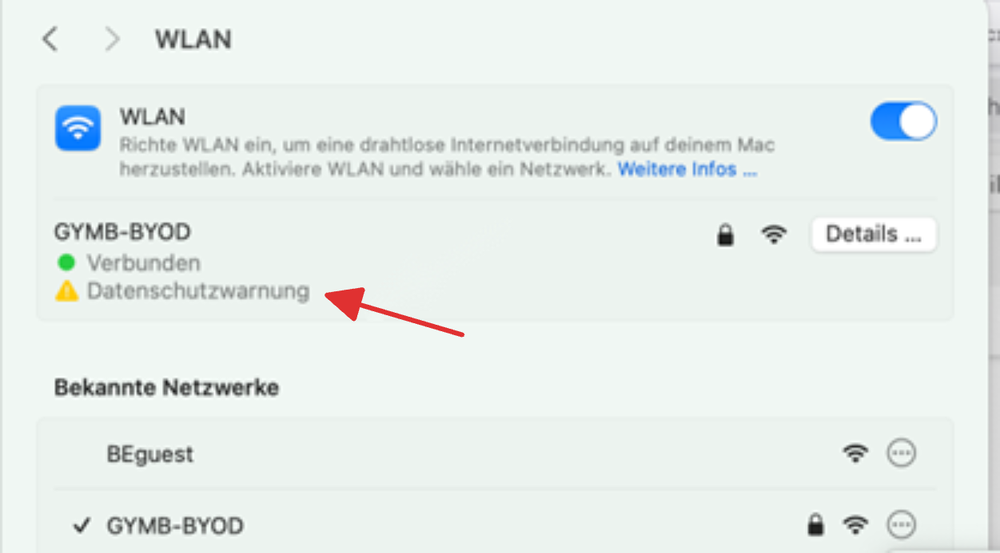
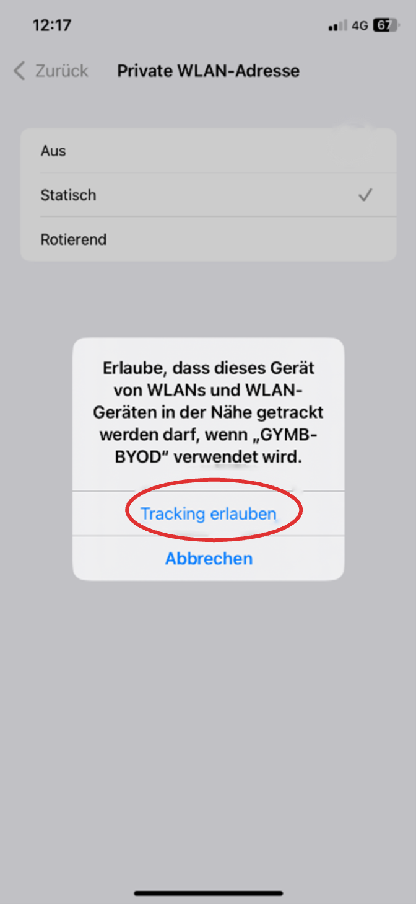
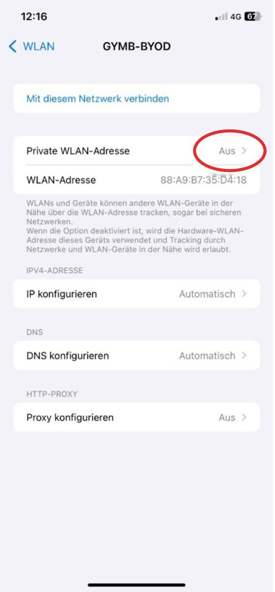
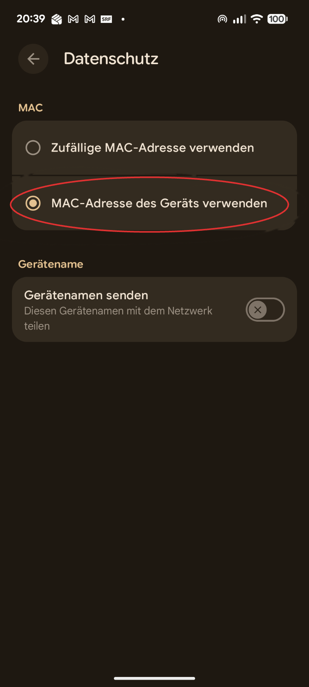
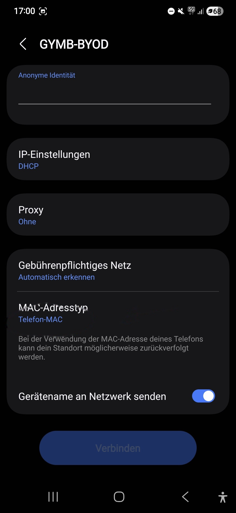

<Faq>
    #### Ich kann mich trotz korrekter Zugangsdaten nicht mit __GYMB-BYOD__ verbinden. Was kann ich tun?
    <Solution>
        Schalten Sie für GYMB-BYOD die private bzw. zufällige WLAN-Adresse aus und verbinden Sie sich erneut:

        <Tabs groupId="os" queryString>
            <TabItem value="win" label="Windows">
                <Steps>
                    1. __Einstellungen__ > __Netzwerk und Internet__ > __WLAN__ öffnen und __Zufällige Hardwareadressen__ auf __Aus__ stellen.
                       
                    2. Mit __GYMB-BYOD__ verbinden.
                    3. Sobald die Verbindung steht, __Zufällige Hardwareadressen__ wieder auf __Ein__ stellen.
                </Steps>
            </TabItem>
            <TabItem value="macos" label="macOS">
                <Steps>
                    1. Oben rechts in der Menüleiste auf :mdi[wifi] klicken und __WLAN-Einstellungen …__ wählen.
                    2. Bei __GYMB-BYOD__ auf __Details …__ klicken.
                    3. __Private WLAN-Adresse__ auf __Aus__ stellen und __Tracking der IP-Adresse beschränken__ ausschalten.
                       
                    4. Mit __GYMB-BYOD__ verbinden. Die __Datenschutzwarnung__ ignorieren: Sie bestätigt, dass die private WLAN-Adresse ausgeschaltet ist.
                       
                </Steps>
            </TabItem>
            <TabItem value="ios" label="iOS">
                <Steps>
                    1. __Einstellungen__ > __WLAN__ öffnen und bei __GYMB-BYOD__ auf ⓘ tippen.
                    2. __Private WLAN-Adresse__ antippen, __Aus__ wählen und mit __Tracking erlauben__ bestätigen.
                       
                    3. Zurück zu GYMB-BYOD: __Private WLAN-Adresse__ zeigt nun __Aus__. Auf __Mit diesem Netzwerk verbinden__ tippen.
                       
                </Steps>
            </TabItem>
            <TabItem value="android" label="Android">
                <Tabs groupId="android-hersteller" queryString>
                    <TabItem value="pixel" label="Google Pixel">
                        <Steps>
                            1. In den Einstellungen unter __WLAN__ auf __GYMB-BYOD__ tippen.
                            2. __Datenschutz__ antippen und __MAC-Adresse des Geräts verwenden__ wählen.
                               
                            3. Mit __GYMB-BYOD__ verbinden.
                        </Steps>
                    </TabItem>
                    <TabItem value="samsung" label="Samsung">
                        <Steps>
                            1. In den Einstellungen unter __WLAN__ auf __GYMB-BYOD__ tippen.
                            2. Nach unten scrollen, __MAC-Adresstyp__ auf __Telefon-MAC__ stellen und auf __Verbinden__ tippen.
                               
                        </Steps>
                    </TabItem>
                </Tabs>
            </TabItem>
        </Tabs>
    </Solution>
</Faq>
